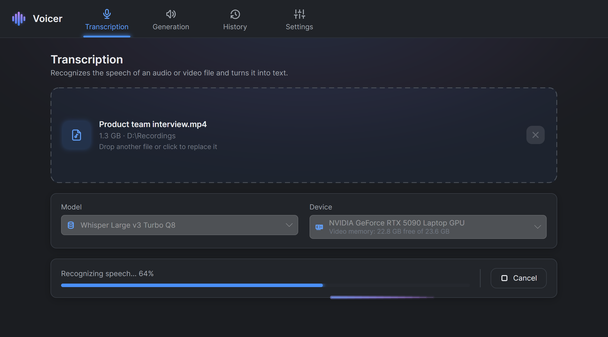

  
  
  
  
  
  

  <a href="https://depthrel.github.io/Voicer/">Project page</a> ·
  <a href="https://github.com/DepthRel/Voicer/releases/latest">Download</a> ·
  <a href="Docs/README.md">Documentation</a>

**Voicer** turns the speech of audio and video files into text, and a text into speech. Everything runs on your own
computer, on the video card or the processor: no cloud, no account, nothing leaves the machine.

## Features

- **Speech to text.** Drop an MP3, WAV, MP4, MKV or any other media file and get its text, with Whisper (large-v3,
  turbo, medium, small) in about a hundred languages. Export to Markdown.
- **Text to speech.** Paste a script, pick a voice or give a sample of your own, and get a narration in WAV.
- **History.** Every text and every narration is kept with its sound and plays back from any moment.
- **Search and questions.** Find records by words or by meaning, ask a question and get an answer with references.
  The found words and passages are marked; the search by meaning runs on a downloaded model, no server needed.
- **Summaries.** A light model of Voicer, or a language model on your own server (LM Studio, Ollama, llama.cpp…),
  sums up a long recording.
- **Six languages** of the interface: English, Deutsch, Español, Français, Português, Русский.

## Getting started

1. Download the package for your system from the [latest release](https://github.com/DepthRel/Voicer/releases/latest):
   the installer or `.zip` for Windows, `.deb` or `.tar.gz` for Linux, `.tar.gz` for macOS.
2. Start Voicer and open **Settings**: download a model (once) and FFmpeg: one click on Windows,
   `sudo apt install ffmpeg` on Linux, `brew install ffmpeg` on macOS.
3. Drop a file on the **Transcription** tab and press **Recognize**.

Build from source: `dotnet build Voicer.slnx`, then `dotnet run --project Sources/Apps/Voicer.UI`.

## Built with

.NET 10 and [Avalonia](https://avaloniaui.net/) ·
[whisper.cpp](https://github.com/ggml-org/whisper.cpp) through [Whisper.net](https://github.com/sandrohanea/whisper.net),
Silero VAD · [llama.cpp](https://github.com/ggml-org/llama.cpp) with Qwen3-TTS, Chatterbox, Kokoro and bge-m3 ·
[FFmpeg](https://ffmpeg.org/) · SQLite · OpenAL Soft. Video cards through Vulkan (Windows, Linux) and Metal (Apple
silicon).

## System requirements

| | |
|---|---|
| System | Windows 10 or newer (x64), Linux x64, macOS (Apple silicon or Intel) |
| Processor | any 64-bit processor: Whisper Small and Kokoro run on it at a usable speed |
| Video card | optional: with Vulkan or Metal, from 1 GB of video memory (Whisper Small) to 4 GB (Large v3) |
| Disk | 0.2–3 GB per model, chosen in the settings |
| Voice generation and the models of Voicer for search and summaries | Windows x64, Linux x64 and macOS on Apple silicon (they run in llama.cpp, which has no build for macOS on Intel; a server of your own works everywhere) |

## License

Free software under the [GNU GPL, version 3 or later](LICENSE.txt). Components of other authors:
[THIRD-PARTY-NOTICES.txt](THIRD-PARTY-NOTICES.txt). Rules for contributors: [AGENTS.md](AGENTS.md).
